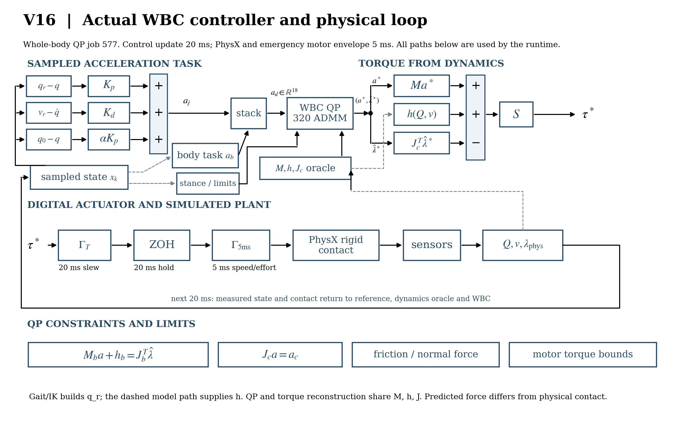
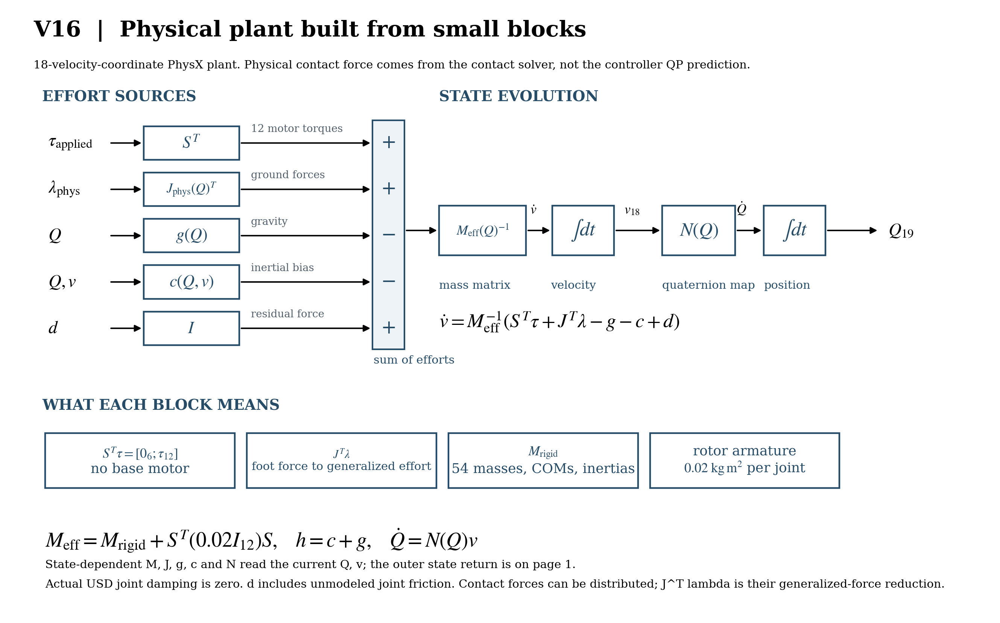
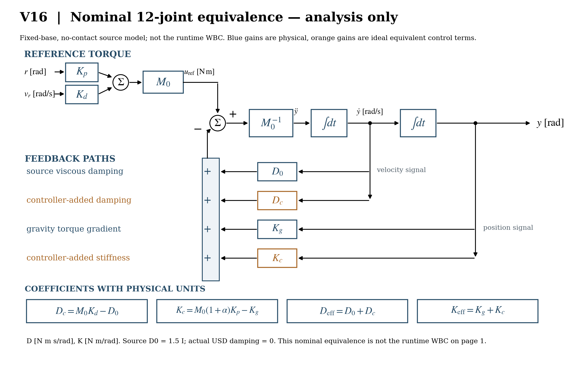
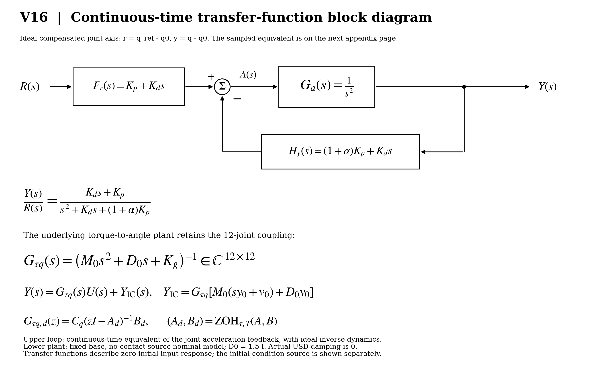
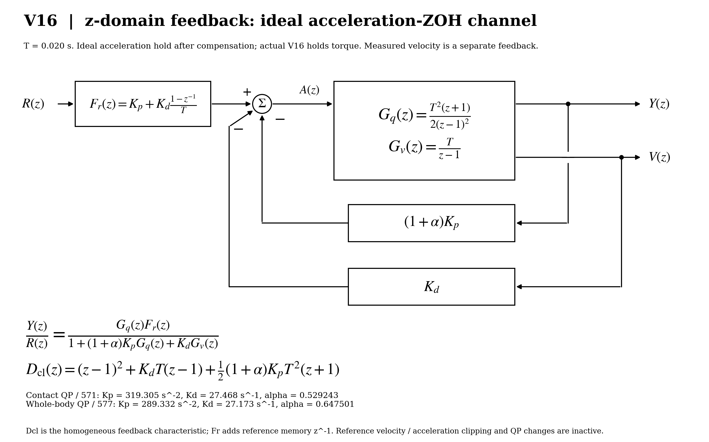
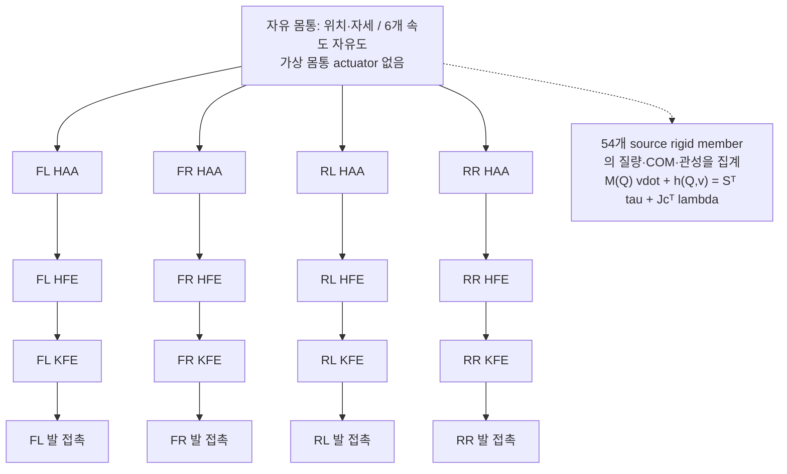
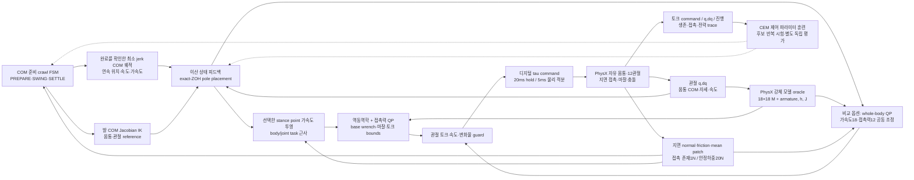
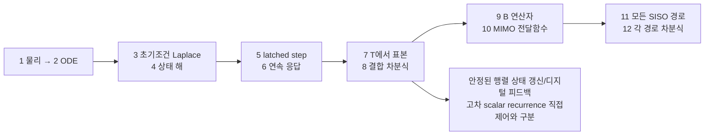

# V16 물리 기반 제어 다이어그램

[실제 WBC부터 시작하는 3쪽 PDF](../reports/v16/figures/v16_modeling_diagrams.pdf) ·
[전달함수·수식 참고 PDF](../reports/v16/figures/v16_control_transfer_diagrams.pdf) ·
[수식 유도와 게인 설명](v16_control_block_diagrams.md)

첫 그림은 실제 훈련된 WBC가 목표 가속도와 접촉력을 계산하고 토크를 PhysX에
적용하는 **20 ms/5 ms 폐루프**다. 두 번째는 그 물리 plant를 작은 힘·관성·적분
블록으로 분해한 것이다. 세 번째의 \(D_c,K_c\)는 로렌츠 교수 방식에 따른
고정 몸통 **이상적 등가 해석**으로, 실제 WBC 코드의 토크 경로와 구분한다.

아래의 연속/이산 전달함수 그림은 [참고 PDF](../reports/v16/figures/v16_control_transfer_diagrams.pdf)에 있다.

아래는 구현 구조를 설명하는 참고 그림이다.
모델 원본·수치 검증은 `v16_12_steps.md`, 실제 실행 결과는 `reports/v16/`에서 확인한다.

## 물리 모델

12DOF는 4다리×3개 구동 관절이다. 몸통 자유도 포함 시 v는18성분이고,
quaternion configuration은19성분이다. 고정 base 시험만 q12,v12,state24가 된다.

## 실제 제어 루프

QP 모드는 base-wrench equality, 비음수 수직력, 보수적인 마찰 피라미드, 토크·속도·변화율 bounds를
80회 ADMM으로 계산한다. 실제 numerical constraint violation과 infeasible tick 비율을 기록한다.
유한 반복 결과와 별도 모터 guard를 사용하므로 feasibility·최적성·보행 안정성을 보장하지 않는다.
기존 LS 배분기를 비교 옵션으로 보존했다. force-only QP는 주어진 가속도를 고정한다.
새 WBC 옵션은 가속도18·접촉력12를 변수로 두고 같은 contact Jacobian으로
몸통 동역학·접촉 가속도·마찰·토크 bounds를 계산한다. 토크는 동역학 식에서 제거해 복원한다.
320회 ADMM이 기본이며 수치 finite/feasible 여부를 기록한다. 이는 preview MPC가 아니다.
WBC는 model controller에서만 허용하고 solver의 비유한 출력은 해당 환경을 absorbing failure로 처리한다.
CPU의 손계산·Torch 검증과 실제 GPU 기립/보행 검증은 구분한다.
준비 보행은 발에 고정된 local ground point의 가속도를 근사한다. 측정 patch는 압력 재분배로 움직일 수 있고
같은 material point가 보장되지 않는다. 발 COM과 collision contact point 차이를 실행 자료에 명시한다.
20ms 동안 command는 유지하지만 5ms emergency effort projection이 활성화되면 실제 applied command는
변할 수 있다. 선형 exact-ZOH 해석은 포화/접촉 phase 변화가 없는 국소 모델에 해당한다.

## 12단계 유도와 온라인 코드의 관계

SISO 경로를 구해도 off-diagonal 관절 결합과 초기조건 응답은 유지된다.
