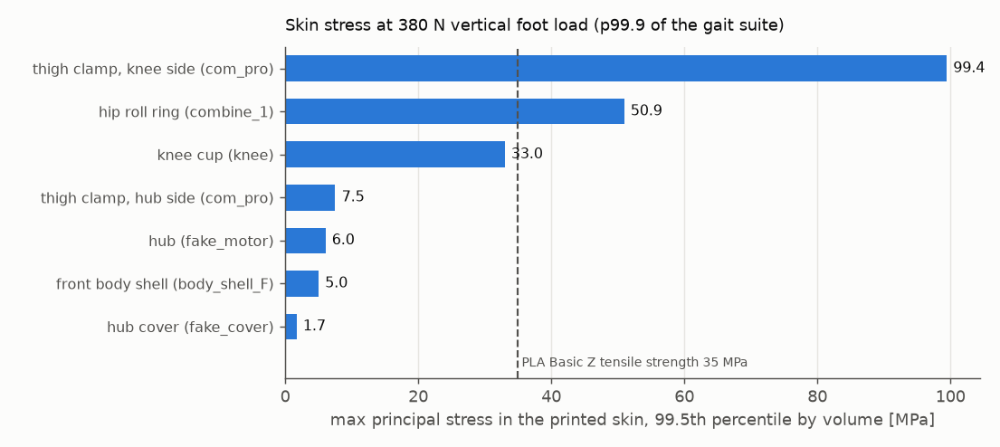
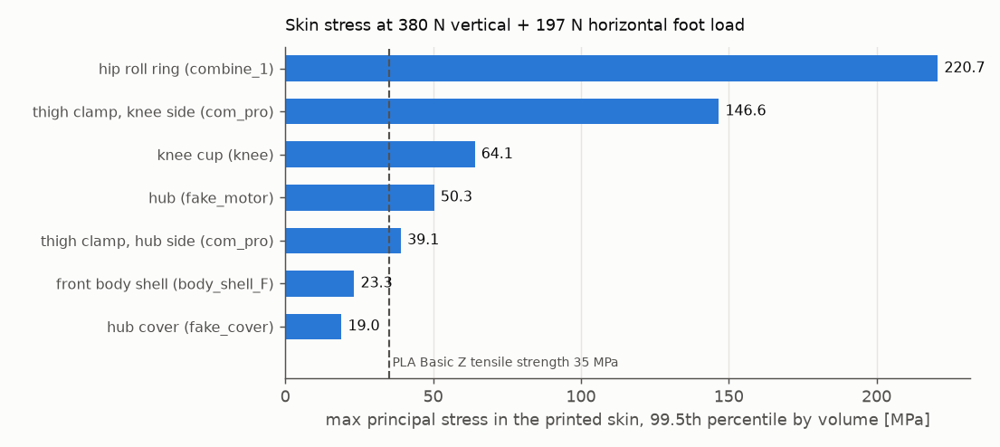
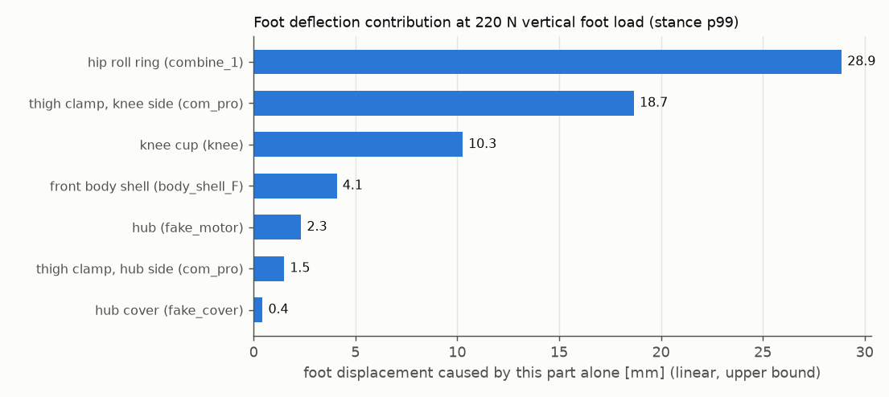
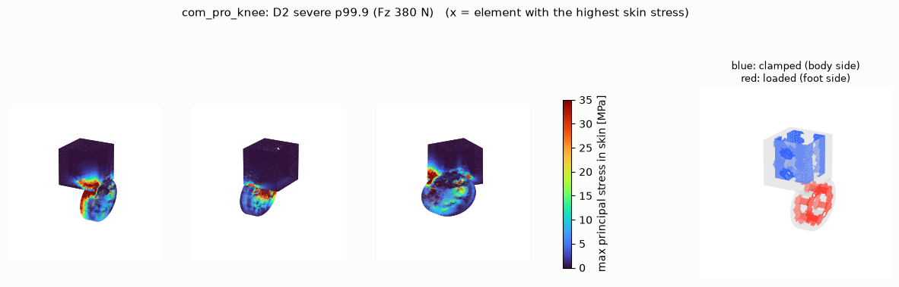
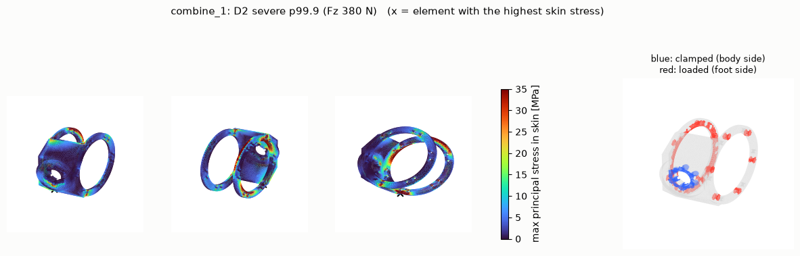
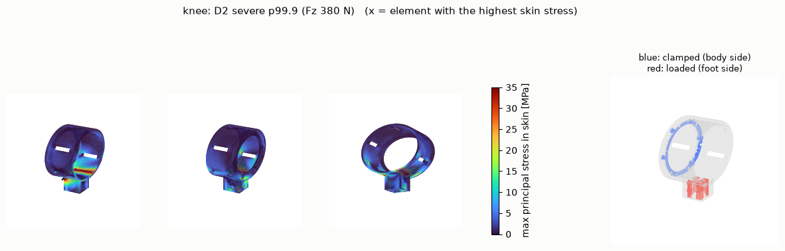
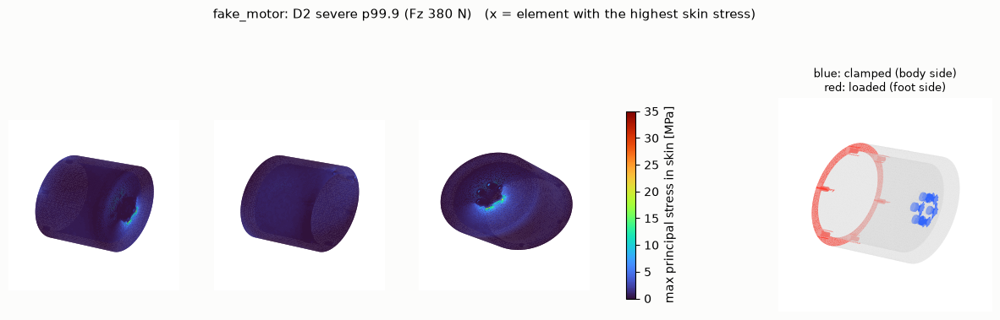
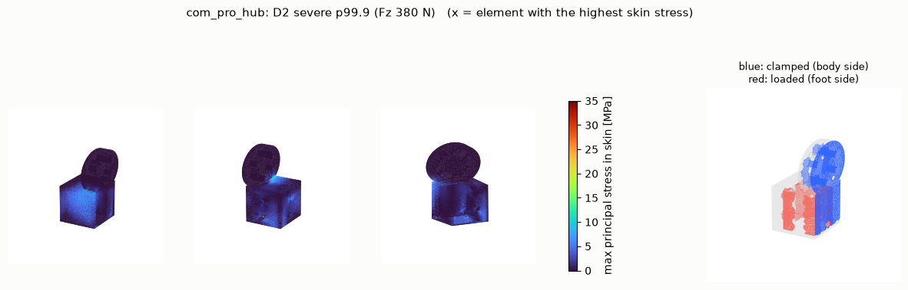
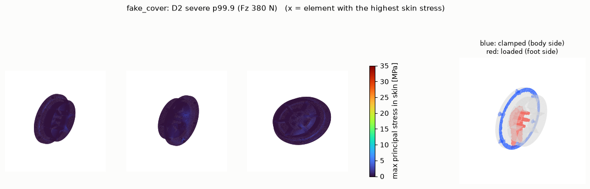
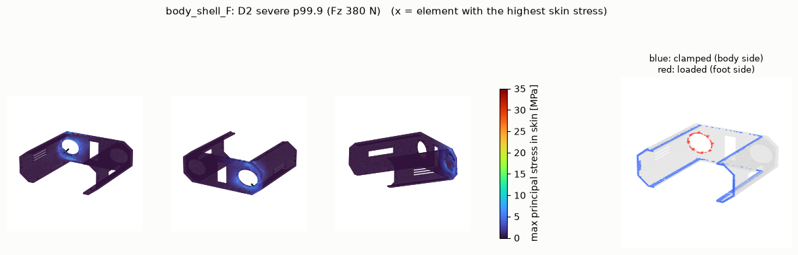

# 사족보행 로봇 출력 부품 구조 해석과 보강안 (2026-10-24)

> **이후 결과 (2026-10-25 추가)**: 이 문서는 v4의 1차 해석이다. 이후 정밀 해석에서 판정 기준을 디딤 p99.9와 15 ms 지속 최대로 바꾸었고, 결론도 일부 바뀌었다.
> 특히 아래 결론 2의 "손가공 알루미늄 덧대기는 이번 주에 권하지 않는다"가 바뀌었다. v4 정밀 해석 최종본은 브래킷 B1(허벅지 클램프 무릎 쪽)과 B2(무릎 컵, 5 mm 판)를 다는 것을 권한다.
> 최신 보고서(v4 정밀 해석 최종본, v6 간이·정밀 해석, V6 재료 분석), 3D 뷰어, 브래킷 1:1 도면은 [`precision_20261024/`](precision_20261024/README.md)에 있다. 같은 파일이 Drive `personal_gdrive:robot_dog/structure_analysis_20261024/`에도 있다.

대상은 `quadruped_robot_20261023.zip`(SHA256 `843749688eba…`)이다. 출력 부품 STL, Bambu 출력 설정, USD 조립 배치, 수정 내역 문서를 썼다.
앞·왼쪽(FL) 다리의 하중 경로에 있는 PLA 부품 7종, 2020 알루미늄 프로파일 2종, 볼트 체결부 7곳을 해석했다.

조건은 **실물 보행 시연까지 일주일**이고, 쓸 수 있는 수단은 Fusion 형상 수정, 3D 프린터(X1C·H2D), 손가공이다. CNC는 쓸 수 없다.
모든 수치는 시뮬레이션 발 반력을 넣은 선형 유한요소 해석과 손계산 결과이며, 실물 시험값이 아니다.

## 결론

**1. 지적하신 두 부위(무릎 쪽, 엉덩이·허벅지 쪽)가 해석에서도 가장 약하다.**

D2 기준(발 수직 380 N, 시뮬레이션 보행의 상위 0.1 %)이고, PLA 강도는 35 MPa(Z방향)다.

| 순위 | 부품 | 스킨 응력 (D2) | 원인 |
|---|---|---|---|
| 1 | 허벅지 클램프, 무릎 쪽 (`com_pro`) | 99 MPa (강도의 2.8배) | 무릎 토크 전부가 Ø39 플랜지와 소켓 블록을 잇는 좁은 목을 지난다. 평상 하중(220 N)에서도 58 MPa로 강도를 넘는다 |
| 2 | 엉덩이 롤 링 (`combine_1`) | 51 MPa | 다리 하중 전체가 AK70-10 출력(Ø30, M3×6 PCD 25)에 매달리고, 두께 4.5 mm 링이 굽힘을 받는다 |
| 3 | 무릎 컵 (`knee`) | 33 MPa (강도에 근접) | 5 mm 백플레이트 한쪽만 고정된 원통이 무릎 토크를 받는다. 약 150 N부터 안쪽 벽이 모터에 닿는다 |

발에 **수평력 197 N이 함께 걸리면(D3)** 상황이 더 나빠진다.
- 엉덩이 쪽 체결 사슬(허브 50 MPa, 허브 쪽 클램프 39 MPa)도 강도를 넘는다.
- 지름 24–25 mm 볼트원의 볼트 하나가 2–3.6 kN의 인장을 받는다.

밀림·넘어짐·미끄러짐에서는 엉덩이 쪽이 먼저 손상될 가능성이 크다.

**2. 일주일 안에 할 일: Fusion 형상 보강 → 인필 100 % 재출력 → 시연 조건 제한** (§6)
- **인필 100 %만으로는 부족하다.** 응력이 0.55–0.95배로 줄 뿐이고, 1·2순위 부품은 여전히 강도를 넘는다(72·48 MPa).
- **형상을 키워야 한다.** 세 부품 모두 키울 공간이 있다(§6.1, 좌표 포함). 고친 STL을 주면 같은 조건으로 바로 다시 해석한다(부품당 5분 안팎).
- **손가공 알루미늄 덧대기는 이번 주에 권하지 않는다.**
  - 무릎 브래킷: 해석상 효과는 크다(컵 응력 0.41배). 하지만 고정할 모터 뒷면 PCD 90 구멍이 컵 안쪽 벽에서 3.7 mm, 모터 Ø71 보스와도 가까워서 손으로 만든 평철이 들어갈 자리가 없다.
  - 허벅지를 허브에 L자로 직결하는 안: 회전 궤적이 몸통 앞판과 2 mm까지 붙는다.
  - 허브 커버를 알루미늄 판(홀쏘·드릴)으로 바꾸는 것은 손가공으로 가능하다. 단, PLA 인서트(J6)를 없애는 정도의 효과라 우선순위는 낮다.
- **알루미늄 가공품 교체**(CNC가 될 때를 위한 참고)는 1·2순위 부품의 처짐을 3–4 %로, 안전율을 3.8·5.7로 만든다(§6.2).

## 1. 범위와 입력

| 항목 | 출처 |
|---|---|
| 형상 | zip `print_stl/*.stl` (출력용 고해상도, 부품 로컬 좌표 mm). 조립 위치는 `isaac_usd/quadruped_robot.usda`의 부품 변환(Fusion 원점·mm와 같음) |
| 재질 지정 | USD 물리 재질(프로파일 알루미늄, 출력물 PLA), 수정 내역 §11 |
| 출력 설정 | `bambu/profiles/process_legs_*.json` (벽 4, 자이로이드 30 %), `process_body_*.json` (벽 3, 20 %). 레이어 0.2 mm, 윗면 5층·아랫면 3층 |
| 체결 | 수정 내역 §3(규격·수량). 메시에서 검출한 구멍으로 PCD 24·25·83·90을 확인했다 |
| 하중 | `reports/v15/cad_rms_20261011/round2` 9개 ROS2/Isaac 시험(`model_15699`)의 `shank_support_force`, `estimated_torque` |

해석 대상은 FL 다리 하나와, 그 다리가 매달린 앞 몸체 셸이다. 다리는 좌우·앞뒤 대칭이라 같은 결론이 적용된다고 보았다.

## 2. 방법

- **요소**: tetgen 사면체 메시 → 2차(P2) 사면체 선형 탄성 해석(scikit-fem, AMG 전처리 CG). 단위 mm·N·MPa.
- **검증**
  - 20×20×200 mm 외팔보 끝단 처짐 7.443 mm. 보 이론 7.463 mm(Euler)·7.523 mm(전단 포함) 대비 1 % 이내.
  - 무릎 컵을 2.5배 거친 메시로 다시 풀어 대표 응력 1 %, 처짐 3 % 차이(메시 영향 작음).
- **경계조건**: 부품마다 몸체 쪽 이웃과 닿는 면을 고정하고, 발 쪽 이웃과 닿는 면에 발 하중을 건다.
  - 하중: 발 접점의 힘과 그 모멘트를 접촉면에 선형 분포 견인력으로 나눠 건다(RBE3 방식).
  - 접촉면: 이웃 표면에서 0.35 mm 이내인 면.
  - 볼트: 직접 모델링하지 않았다. 구멍 축이 이웃 부품으로 이어지는 볼트 구멍의 벽과 머리 자리(구멍 반지름 + 2 mm)를 그 면에 포함했다.
- **자세**: 시뮬레이션 기준 서기 자세(엉덩이 피치 +0.55 rad, 무릎 +1.1 rad, 롤 0). 발 접점은 엉덩이 바로 아래 536 mm다.
- **출력물 재질**: 표면에서 벽 두께 이내는 솔리드 PLA, 안쪽은 자이로이드 코어로 본다.
  - 벽 두께: 다리 1.77 mm(0.42 + 3×0.45), 몸체 1.32 mm.
  - 요소 안의 다섯 점이 스킨에 드는 비율로 탄성계수를 섞었다.
  - 응력은 같은 변형률에서 솔리드 PLA 스킨이 받는 값으로 평가한다.

| 재료 | 값 | 출처 |
|---|---|---|
| PLA 스킨 | E 2680 MPa, ν 0.35 | Bambu PLA Basic TDS V2.0 (E X-Y 2680, Z 2160 MPa). ν는 TDS에 없어 가정 |
| PLA 강도 | 인장 Z 35 / X-Y 39 MPa, 굽힘 Z 68 / X-Y 76 MPa, 열변형온도 54 °C (1.8 MPa) | 같은 TDS (100 % 인필, 55 °C 어닐링 시편) |
| 자이로이드 코어 | E = 2680 × ρ² (30 % → 241 MPa, 20 % → 107 MPa) | Gibson–Ashby 굽힘 지배 추정(가정) |
| 알루미늄 | E 68.9 GPa, ν 0.33, 항복 276 MPa | 수정 내역 §11의 6061, 일반 6061-T6 값. 실제 압출재 합금·조질은 미확인 |

판정은 스킨 최대 주응력의 **체적 상위 0.5 %를 뺀 값(p99.5)**을 PLA Z방향 인장강도 35 MPa와 비교한다.
- 최댓값은 고정면 모서리 같은 특이점에서 메시에 따라 커지므로 참고로만 적었다.
- PLA는 반복 하중과 크리프에 약하므로, 실사용에는 안전율 3 이상을 권한다(판단 기준).

## 3. 하중

| 경우 | 발 힘 (월드) | 근거 |
|---|---|---|
| D1 평상 | 수직 220 N | 9개 시험 전체 `shank_support_force` 상위 1 % (p99) |
| D2 심함 | 수직 380 N | p99.9 |
| D3 심함 + 수평 | 수직 380 N + 수평 197 N(±x, ±y 중 가장 나쁜 방향) | 197 N은 요철 시험의 최대 수평력 |
| D4 충격 | 수직 1045 N | 단일 표본 최대값(측면 이동 시험). 접촉 순간값일 가능성 |

참고:
- 서기 정지 중앙값은 약 58 N, 걸을 때 디딤발 중앙값은 약 100 N이다.
- 무릎 토크 최대 47.5 N·m는 토크 가드 한도다.
- 기준 자세에서 D2는 무릎 토크 62.5 N·m를 요구한다. 실제로는 그 전에 무릎이 접히므로, 무릎 사슬에 대해 D2는 보수적인 값이다.
- 다리 질량과 관성은 무시했다.

## 4. 부품별 결과

| 부품 | 스킨 응력 p99.5 [MPa] D1 / D2 / D3 | 최대값 D2 [MPa] | 안전율 D2 (p99.5) | 발끝 처짐 기여 D1 [mm] | 판정 |
|---|---|---|---|---|---|
| 허벅지 클램프, 무릎 쪽 (com_pro) | 57.6 / 99.4 / 146.6 | 288 | 0.35 | 18.7 | **불합격** (평상 하중대에서 강도 초과) |
| 엉덩이 롤 링 (combine_1) | 29.5 / 50.9 / 220.7 | 180 | 0.69 | 28.9 | **불합격** (평상 하중대에서 강도 초과) |
| 무릎 컵 (knee) | 19.1 / 33.0 / 64.1 | 130 | 1.06 | 10.3 | **주의** (수평력이 더해지면 초과) |
| 허브 (fake_motor) | 3.5 / 6.0 / 50.3 | 21 | 5.80 | 2.3 | **주의** (수평력이 더해지면 초과) |
| 허벅지 클램프, 허브 쪽 (com_pro) | 4.4 / 7.5 / 39.1 | 32 | 4.66 | 1.5 | **주의** (수평력이 더해지면 초과) |
| 허브 커버 (fake_cover) | 1.0 / 1.7 / 19.0 | 4 | 20.56 | 0.4 | 여유 작음 (안전율 < 2) |
| 앞 몸체 셸 (body_shell_F) | 2.9 / 5.0 / 23.3 | 28 | 6.99 | 4.1 | 여유 작음 (안전율 < 2) |
| 허벅지 2020 알루미늄 | 55.6 / 96.0 / 343.9 | 152 | 2.87 | 13.5 | **주의** (수평력이 더해지면 초과) |
| 정강이 2020 알루미늄 | 38.8 / 67.0 / 122.6 | 125 | 4.12 | 1.3 | 양호 |

- **발끝 처짐 기여**: 그 부품만 변형하고 나머지는 강체일 때 발이 움직이는 양이다.
  - 접촉을 붙여 둔 선형 해석이라 상한값이며, 부품끼리 비교하는 용도다. 합산해서 실제 처짐으로 읽으면 안 된다.
  - 무릎 컵은 약 150 N부터 안쪽 벽이 0.5 mm 틈을 넘어 모터에 닿는다(D1에서 최대 0.76 mm, 안쪽 벽의 4 %). 실제로는 이보다 단단하다.
- **허벅지 2020 프로파일**: 강도는 충분하지만 비틀림에 약하다. 정강이가 허벅지보다 43 mm 안쪽에 있어서 수직 하중이 허벅지를 비튼다.
  D3의 큰 값은 소켓 끝단의 응력 집중과 비틀림이 겹친 결과다.
- **몸체 셸**: 수직 하중에는 여유가 있다(D2 5 MPa). D3에서는 롤 모터 장착부 주변이 23 MPa다.





부품별 응력 분포(D2). 색은 35 MPa에서 포화하고, 오른쪽은 경계조건(파랑: 고정, 빨강: 하중)이다.

| | |
|---|---|
|  |  |
|  |  |
|  |  |
|  |  |

메시 정보:

| 부품 | 사면체 | 자유도 | 고정면 [mm²] | 하중면 [mm²] | 스킨 체적비 | 계산 시간 [s] |
|---|---|---|---|---|---|---|
| 허벅지 클램프, 무릎 쪽 (com_pro) | 101,228 | 544,821 | 2252 | 1433 | 0.76 | 288 |
| 엉덩이 롤 링 (combine_1) | 60,657 | 328,320 | 1319 | 3778 | 0.79 | 318 |
| 무릎 컵 (knee) | 79,421 | 399,420 | 2816 | 2246 | 0.69 | 265 |
| 허브 (fake_motor) | 110,931 | 524,976 | 1284 | 2959 | 0.45 | 304 |
| 허벅지 클램프, 허브 쪽 (com_pro) | 101,332 | 545,745 | 2973 | 2254 | 0.76 | 247 |
| 허브 커버 (fake_cover) | 75,729 | 371,040 | 2308 | 3101 | 0.56 | 170 |
| 앞 몸체 셸 (body_shell_F) | 123,648 | 670,056 | 15065 | 2221 | 0.43 | 546 |
| 허벅지 2020 알루미늄 | 85,928 | 489,273 | 1853 | 1870 | 1.00 | 379 |
| 정강이 2020 알루미늄 | 86,803 | 493,254 | 1857 | 1006 | 1.00 | 362 |

## 5. 체결부 (손계산)

볼트원 반지름 r, 볼트 n개일 때 볼트당 인장 = 2·M_b/(n·r) + 분리력/n, 전단 = V/n + T/(n·r)로 잡았다.
마찰·핀은 무시했고 플랜지는 강체로 보았다.

| 체결부 | 볼트 | 나사가 물리는 곳 | D1 볼트당 인장/전단 [N] | D2 | D3 (수평력 포함) |
|---|---|---|---|---|---|
| J1 AK70-10 하우징 → 몸체 셸 끝판 | 8×M3 PCD 83 | 모터 나사, PLA 판 8 mm 체결 | 103 / 74 | 178 / 127 | 819 / 127 |
| J2 AK70-10 출력 → 엉덩이 롤 링 | 6×M3 PCD 25 | 모터 나사, PLA 보스 체결 | 422 / 242 | 729 / 417 | 3596 / 417 |
| J4 엉덩이 AK10-9 출력 → 허브 끝벽 | 6×M4 PCD 24 | 모터 나사, PLA 끝벽 9 mm 체결 (+핀 2) | 239 / 76 | 414 / 132 | 3380 / 132 |
| J5 허브 테두리 → 허브 커버 | 6×M3 PCD 90 | PLA 안의 M3 히트셋 인서트 | 42 / 47 | 73 / 82 | 855 / 82 |
| J6 허브 커버 → 허브 쪽 클램프 | 6×M4 PCD 24 | PLA 원판(5 mm) 안의 M4 히트셋 인서트 | 188 / 76 | 325 / 132 | 3259 / 132 |
| J9 무릎 쪽 클램프 → 무릎 모터 출력 | 6×M4 PCD 24 | 모터 나사, PLA 플랜지 7.5 mm 체결 (+핀) | 188 / 539 | 325 / 932 | 2140 / 932 |
| J10 무릎 모터 하우징 → 무릎 컵 백플레이트 | 6×M4 PCD 90 | 모터 나사, PLA 판 5 mm 체결 | 34 / 171 | 58 / 295 | 536 / 295 |

- **D3에서 PCD 24·25 체결부의 볼트 하나가 2–3.6 kN의 인장을 받는다.**
  - J2(M3)는 8.8급 M3의 보증하중 수준이다.
  - J6은 PLA 원판(5 mm) 속 M4 인서트가 이 힘을 버텨야 한다. PLA 속 M4 인서트의 뽑힘 하중은 신뢰할 출처를 찾지 못했다.
- **J9(무릎 쪽 클램프)는 무릎 토크를 PCD 24로 받는다.** 핀 없이 볼트만으로 받으면 7.5 mm PLA 플랜지의 구멍 지압이 약 31 MPa(D2)다.
  수정 내역 §3의 "무릎 모터 쪽 다월핀 필수 권장"을 반드시 지켜야 한다.

## 6. 보강안

### 6.1 이번 주: Fusion 형상 보강 (FL 다리 기준 좌표, mm)

D2에서 35 MPa를 넘는 영역과 주변 여유를 메시로 측정해 정했다. 세 부품 모두 컴포넌트를 공유하므로 한 번 고치면 네 다리 전부에 반영된다.

| 부품 | 넘는 영역 (D2) | 고칠 것 | 쓸 수 있는 공간 |
|---|---|---|---|
| **허벅지 클램프 (`com_pro`, 8개 공용)** | 플랜지 위쪽 절반과 소켓 블록으로 이어지는 목, 전체 폭. x −210.9 … −200.7, z −222.8 … −193.6 (990 mm³) | ① 플랜지 두께 7.5 → **15 mm**. 모터 쪽 면(x −200.7)은 그대로 두고 바깥쪽(−x)으로 키운다 ② 플랜지와 소켓 블록 사이 목을 **전체 폭 솔리드**로 채우고 모서리 R5 이상 ③ 볼트 M4×12 → **M4×20**(모터 출력 나사 깊이 7 mm 안에서 물림 5 mm) | 플랜지 바깥쪽(x < −208)은 무릎이 돌아도 정강이 부품(x ≥ −200.7)과 겹치지 않는다. 허브 쪽 인스턴스도 바깥쪽이 비어 있다 |
| **엉덩이 롤 링 (`combine_1`, 4개)** | 바깥 링(x −125 … −120.5)이 보스와 만나는 위아래 구간 (y 277–306, 326–357) | ① 두 링 두께 4.5 → **8 mm** ② 링과 보스 판을 잇는 **리브** 추가 ③ 볼트 길이 +3.5 mm. 출력 쪽 M4 나사 깊이 8 mm, 뒤쪽 4 mm를 넘지 않게 한다 | 바깥 링에서 허브(fake_motor, x −130.7)까지 5.7 mm → 3.5 mm 키워도 2.2 mm 남는다. 허브는 같은 축으로 돌아서 간격이 변하지 않는다 |
| **무릎 컵 (`knee`, 4개)** | 소켓 블록이 원통 바닥에 붙는 양옆. x −191 … −155, y 296–309·322–331, z −275 … −260 | ① 소켓 블록 양옆(y 방향)에 원통까지 올라가는 **삼각 리브**(두께 8 mm 이상) ② 백플레이트 5 → **7 mm**. 바깥쪽(x −197.5까지)으로 키우고 볼트 M4×12 → M4×14 ③ 바닥 근처에는 통풍창을 두지 않는다 | 백플레이트 바깥 면(x −195.5)에서 무릎 쪽 클램프 면(x −200.7)까지 5.2 mm. 두 부품은 무릎 축으로 서로 돌므로 2 mm만 키워 3.2 mm를 남긴다. 그 안쪽 모터 면은 반지름 38 mm 이내라 백플레이트 고리(반지름 41.3–55 mm)와 겹치지 않는다 |

- **출력**: 세 부품 16개를 **인필 100 %**(또는 벽 8줄 이상 + 인필 60 % 이상)로 출력한다. PLA는 Bambu PLA Basic을 그대로 쓴다.
- **효과 확인**: 인필 100 %만 했을 때는 위 표의 0.73–0.95배였다(§6.2). 형상 보강의 효과는 고친 STL로 다시 해석해 확인한다.
- 무릎 브래킷 해석(소켓 바깥면을 모터에 강하게 묶은 상한)에서 컵 응력이 0.41배로 줄었다. 소켓과 컵 몸통을 단단히 잇는 리브가 효과적이라는 근거다.

### 6.2 해석 비교

같은 메시·같은 하중으로 재질이나 경계조건만 바꿨다. 알루미늄 행의 안전율은 6061-T6 항복 276 MPa 기준이다.

| 부품 | 변경 | 스킨 응력 p99.5 D2 [MPa] | D3 [MPa] | 발끝 처짐 D1 [mm] | D2 안전율 |
|---|---|---|---|---|---|
| 무릎 컵 (knee) | 인필 100 % 출력 | 33.0 → **25.7** (0.78×) | 64.1 → **50.2** | 10.26 → **7.14** (0.70×) | 1.06 → **1.36** |
| 무릎 컵 (knee) | 알루미늄 무릎 브래킷 (강체 연결 상한) | 33.0 → **13.6** (0.41×) | 64.1 → **26.4** | 10.26 → **1.91** (0.19×) | 1.06 → **2.58** |
| 무릎 컵 (knee) | 메시 2.5배 거칠게 (민감도 확인) | 33.0 → **32.7** (0.99×) | 64.1 → **63.9** | 10.26 → **9.98** (0.97×) | 1.06 → **1.07** |
| 허벅지 클램프, 무릎 쪽 (com_pro) | 인필 100 % 출력 | 99.4 → **72.5** (0.73×) | 146.6 → **120.2** | 18.67 → **14.27** (0.76×) | 0.35 → **0.48** |
| 허벅지 클램프, 허브 쪽 (com_pro) | 인필 100 % 출력 | 7.5 → **5.7** (0.75×) | 39.1 → **33.6** | 1.50 → **1.24** (0.83×) | 4.66 → **6.19** |
| 허브 커버 (fake_cover) | 인필 100 % 출력 | 1.7 → **1.1** (0.62×) | 19.0 → **12.9** | 0.44 → **0.21** (0.47×) | 20.56 → **33.16** |
| 허브 커버 (fake_cover) | 알루미늄 6061 가공품으로 교체 | 1.7 → **1.1** (0.62×) | 19.0 → **12.9** | 0.44 → **0.01** (0.02×) | 20.56 → **261.51** |
| 허브 (fake_motor) | 인필 100 % 출력 | 6.0 → **3.3** (0.55×) | 50.3 → **28.5** | 2.33 → **1.14** (0.49×) | 5.80 → **10.45** |
| 허브 (fake_motor) | 허브 끝벽을 알루미늄 판으로 (관과 일체 가정, 상한) | 6.0 → **1.5** (0.24×) | 50.3 → **5.7** | 2.33 → **0.08** (0.03×) | 5.80 → **23.77** |
| 엉덩이 롤 링 (combine_1) | 인필 100 % 출력 | 50.9 → **48.4** (0.95×) | 220.7 → **213.4** | 28.87 → **27.03** (0.94×) | 0.69 → **0.72** |
| 엉덩이 롤 링 (combine_1) | 알루미늄 6061 가공품으로 교체 | 50.9 → **48.4** (0.95×) | 220.7 → **213.4** | 28.87 → **1.05** (0.04×) | 0.69 → **5.70** |
| 허벅지 클램프, 무릎 쪽 (com_pro) | 알루미늄 6061 가공품으로 교체 | 99.4 → **72.5** (0.73×) | 146.6 → **120.2** | 18.67 → **0.56** (0.03×) | 0.35 → **3.81** |

- "상한"은 덧댄 알루미늄과 PLA 사이 이음을 완전히 단단하다고 본 값이다. 실제 효과는 이음 강성만큼 줄어든다.
- 알루미늄 교체 행은 형상이 같으므로 응력은 PLA 솔리드와 같고 처짐만 크게 준다(CNC가 가능해질 때의 참고).

### 6.3 검토했지만 이번 주에는 권하지 않는 안

| 안 | 이유 |
|---|---|
| 무릎 알루미늄 브래킷 (모터 뒷면 6×M4 PCD 90 ↔ 소켓 바깥면) | 구멍이 플랜지 면(x −152.2)에 있다. 이 면은 컵 테두리 안쪽 4.7 mm에 있고, 컵 안벽에서 3.7 mm, Ø71 보스와도 가깝다. 손가공 평철로는 보스와 컵 벽을 동시에 피하지 못하고, 고리 형태는 레이저·CNC가 필요하다 |
| 허벅지를 허브에 L자로 직결 | 허벅지와 함께 도는 앵글의 궤적(반지름 약 55 mm)이 몸통 앞판(y 258)과 2 mm까지 붙는다 |
| 허브 커버를 알루미늄 판으로 교체 | 손가공(홀쏘 + 드릴 가이드)으로 가능하다. 다만 효과가 PLA M4 인서트(J6)를 없애는 정도라, 시간이 남을 때만 권한다 |

## 7. 일주일 일정과 시연 조건

| 날 | 할 일 |
|---|---|
| 1일 | Fusion 수정 3종(§6.1) → STL → 같은 조건으로 재해석해 확인 |
| 2–3일 | X1C·H2D로 16개 출력(인필 100 %). 무릎 쪽 클램프는 **예비 1세트 더** |
| 4일 | 조립(다월핀 포함). 서기 → 제자리 걸음으로 확인. 출력물이 하얗게 변하거나 금이 가는지 점검 |
| 5–6일 | 저속 보행 리허설 |
| 7일 | 여유 |

시연 조건:
- 걷기 속도를 낮게 유지한다.
- **옆으로 밀기·넘어짐 복구 시연은 하지 않는다**(D3에서 엉덩이 쪽 강도 초과).
- 리허설은 안전줄을 건 상태로 한다.
- 오래 서 있지 않는다(PLA 크리프).
- 무릎 컵과 허브는 모터를 감싼다. PLA 열변형온도가 54 °C이므로 리허설마다 모터 표면 온도를 잰다.

## 8. 한계

- 선형 탄성, 접촉 고정(분리·미끄럼 없음), 볼트 미모델링. 볼트 예압, 접촉 분리, 모터 하우징과의 접촉은 반영하지 않았다.
- 출력물은 등방성 스킨과 균질 코어로 단순화했다. 실제로는 레이어 방향(Z)이 더 약하고 결함·공극의 영향이 있다.
- PLA의 크리프, 피로, 온도는 반영하지 않았다.
- 하중은 시뮬레이션 발 반력이며 실측이 아니다. 자세는 기준 서기 하나로 고정했다.
- 부품을 하나씩 떼어 해석했으므로, 이웃 부품 강성의 상호작용은 반영되지 않았다.

## 9. 재현

스크립트는 [`config/experiments/structure_20261023/`](../../config/experiments/structure_20261023/)에 있다.
- `analyze_parts.py`: 부품 해석
- `post.py`: 하중 조합과 그림
- `joints.py`: 체결부 손계산
- `compare.py`: 보강안 비교
- `charts.py`·`tables.py`: 보고서 차트와 표

zip을 gcode·3mf 없이 풀고 `QR_ROOT`로 지정한 뒤 실행한다. numpy 2.x, scipy, scikit-fem, pyamg, tetgen이 필요하다.

```bash
unzip quadruped_robot_20261023.zip -x '*.gcode' '*.3mf' -d <dir>
export QR_ROOT=<dir>/quadruped_robot
python3 analyze_parts.py knee com_pro_knee ...   # 부품당 3–9분, 메모리 약 4–5 GB
python3 post.py knee ...; python3 joints.py; python3 compare.py
```

고친 부품을 다시 해석하려면 같은 이름으로 `print_stl/`에 STL을 넣고, 해당 부품만 다시 실행하면 된다.

결과 수치는 [`data/`](data/)에 있다(부품별 요약 JSON, `joints.json`, `compare.json`).
