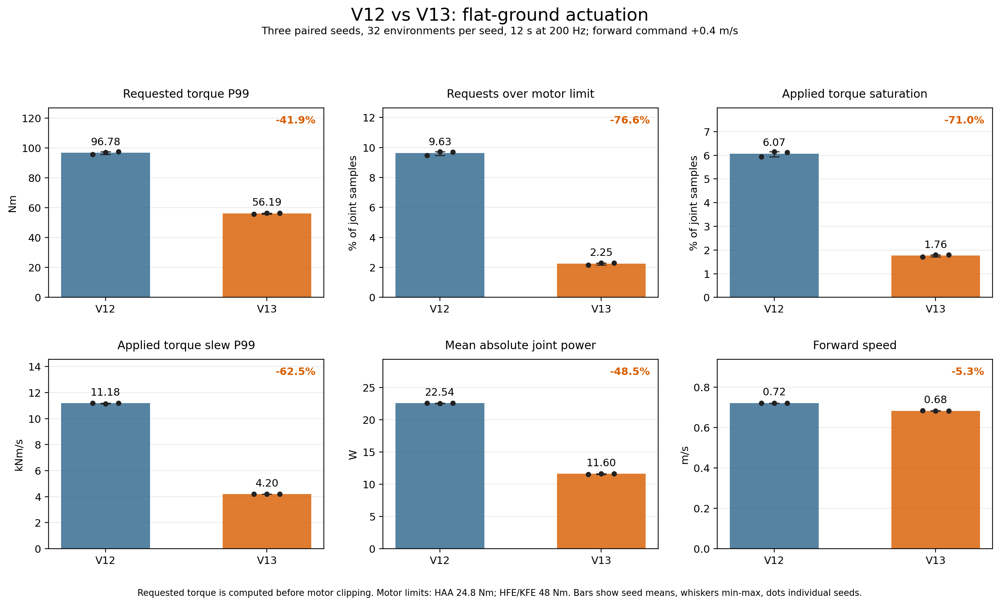

# V13 토크 비교

후속 모터 토크 가드와 험지·계단 검증 결과는
[`GUARD_VALIDATION.md`](GUARD_VALIDATION.md)에 있다.

V12 depth→scan 학생 모델을 고정하고 V11 보행 액터를 PPO로 1,500회 추가 학습한 V13을 비교했다.
두 정책은 같은 V12 학생 체크포인트(`74c0c156…`)와 로봇 USD를 사용한다. 평지에서
전진 명령 `+0.4 m/s`, 준비 구간 2초 후 측정 12초, 시드 42·43·44 각각 32개 환경으로
평가했다. 토크는 200 Hz 물리 스텝마다 기록했다.

| 측정값 (3개 시드 평균) | V12 | V13 | 변화 |
| --- | ---: | ---: | ---: |
| 요청 토크 P99 (Nm) | 96.78 | 56.19 | −41.9% |
| 모터 한계 초과 요청 비율 | 9.63% | 2.25% | −76.6% |
| 실제 토크 한계 포화 비율 | 6.07% | 1.76% | −71.0% |
| 실제 토크 변화율 P99 (kNm/s) | 11.18 | 4.20 | −62.5% |
| 평균 관절 절대 기계 파워 (W) | 22.54 | 11.60 | −48.5% |
| 평균 전진 속도 (m/s) | 0.720 | 0.682 | −5.3% |

각 평가에서 32개 환경이 측정 구간 끝까지 생존했다. `requested` 토크는 모터 한계를
적용하기 전 계산값이고, `applied` 토크는 제한을 적용한 값이다. 모터 한계는 HAA
24.8 Nm, HFE/KFE 48 Nm다. 위 결과는 짧은 평지 시험의 토크 감소를 보여주며,
계단·험지 보행이나 실기 안전성을 검증한 결과는 아니다.

원본 요약 JSON은 [`data/`](data/)에 있고, 그래프는 [`plot_torque.py`](plot_torque.py)로
재생성한다. 그래프의 막대는 세 시드 평균, 검은 점은 각 시드, 수염은 최소·최대값이다.
